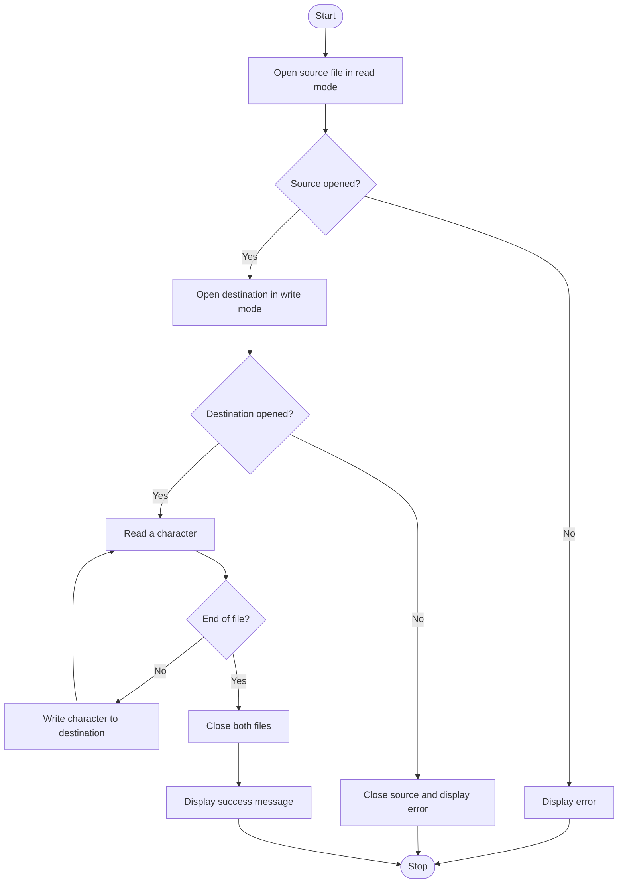

# File-Handling-in-C


# Assignment 09: Copying Contents of One File to Another Using File Handling in C

## 1. Problem Statement

Write a C program to copy the contents of one file to another using file handling.

## 2. Objectives

- To study file handling in C.
- To understand how files are opened, read, written, and closed.
- To learn the use of file pointers.
- To understand the working of `fopen()` and `fclose()`.
- To implement file copying using character input and output functions.
- To understand different file opening modes in C.

## 3. Theory

### What Is a File?

A file is a collection of data stored on a storage device. Files allow data to be stored permanently, even after a program has finished executing.

In C programming, file handling allows us to create, open, read, write, append, and close files using functions provided by the standard input/output library.

The `stdio.h` header file contains the declarations of commonly used file handling functions.

### What Is File Handling in C?

File handling is the process of performing operations on files through a program. It is useful when information needs to be stored permanently or transferred from one file to another.

Common file handling operations include:

- Opening a file.
- Reading data from a file.
- Writing data to a file.
- Appending data to a file.
- Closing a file.

### What Is a `FILE *` Pointer?

A `FILE *` pointer is used to refer to a file opened by a C program. It allows file handling functions to access the information associated with that file.

**Syntax:**
```c
FILE *fp;
```

**Example:**
```c
FILE *fp;
fp = fopen("input.txt", "r");
```

Here, `fp` is a file pointer used to access the file named `input.txt`.

### What Is the `fopen()` Function?

The `fopen()` function opens a file in the specified mode and returns a file pointer.

**Syntax:**
```c
FILE *fopen(const char *filename, const char *mode);
```

**Example:**
```c
FILE *fp = fopen("input.txt", "r");
```

In this example, the file `input.txt` is opened in read mode.

If the file cannot be opened, `fopen()` returns `NULL`. Therefore, the returned pointer should be checked before performing file operations.

### What Is the `fclose()` Function?

The `fclose()` function closes an opened file and releases the resources associated with it.

**Syntax:**
```c
fclose(fp);
```

Closing files after completing file operations is important because it ensures that buffered output is properly handled and resources are released.

### What Are `fgetc()` and `fputc()`?

- **`fgetc()`** reads one character at a time from a file.
- **`fputc()`** writes one character at a time to a file.

**Example:**
```c
int ch;

ch = fgetc(fp);
fputc(ch, fp2);
```

The return value of `fgetc()` should be stored in an `int`, not a `char`, so that it can represent every possible character value as well as the special value `EOF`, which indicates the end of a file or a read error.

### Different File Opening Modes

| Mode | Purpose |
|---|---|
| `"r"` | Opens an existing file for reading. |
| `"w"` | Opens a file for writing. Creates it if necessary and truncates it if it already exists. |
| `"a"` | Opens a file for appending data at the end. |
| `"r+"` | Opens an existing file for both reading and writing. |
| `"w+"` | Opens a file for reading and writing; creates or truncates it. |
| `"a+"` | Opens a file for reading and appending. |

For this assignment, the source file is opened in `"r"` mode, while the destination file is opened in `"w"` mode.

## 4. Algorithm

1. Start the program.
2. Declare two file pointers for the source and destination files.
3. Declare an integer variable to store each character read from the source file.
4. Open the source file, `input.txt`, in read mode.
5. Check whether the source file opened successfully.
6. Open the destination file, `output.txt`, in write mode.
7. Check whether the destination file opened successfully.
8. Read characters from the source file using `fgetc()`.
9. Write each character to the destination file using `fputc()`.
10. Continue until the end of the source file is reached.
11. Close both files using `fclose()`.
12. Display a success message.
13. Stop the program.

## 5. C Program

```c
#include <stdio.h>

int main()
{
    FILE *source, *destination;
    int ch;

    source = fopen("input.txt", "r");

    if (source == NULL)
    {
        printf("Error opening source file.\n");
        return 1;
    }

    destination = fopen("output.txt", "w");

    if (destination == NULL)
    {
        printf("Error opening destination file.\n");
        fclose(source);
        return 1;
    }

    while ((ch = fgetc(source)) != EOF)
    {
        if (fputc(ch, destination) == EOF)
        {
            printf("Error writing to destination file.\n");
            fclose(source);
            fclose(destination);
            return 1;
        }
    }

    if (ferror(source))
    {
        printf("Error reading source file.\n");
        fclose(source);
        fclose(destination);
        return 1;
    }

    fclose(source);
    fclose(destination);

    printf("File copied successfully.\n");

    return 0;
}
```

### Explanation of the Program

- `#include <stdio.h>` includes the standard input/output library containing file handling functions.
- `FILE *source, *destination;` declares two file pointers.
- `int ch;` stores each character read from the source file and can also represent `EOF`.
- `fopen("input.txt", "r")` opens the source file in read mode.
- `source == NULL` checks whether the source file failed to open.
- `fopen("output.txt", "w")` opens the destination file in write mode.
- `destination == NULL` checks whether the destination file failed to open.
- `fgetc(source)` reads one character from the source file.
- `fputc(ch, destination)` writes that character to the destination file.
- `EOF` indicates that the reading loop has reached the end of the file or encountered a read error.
- `ferror(source)` checks whether a file-reading error occurred.
- `fclose()` closes the files after processing.
- `return 0;` indicates successful program execution.

**Important:** Create `input.txt` in the same working directory as the program before running it. Opening `output.txt` in write mode will create it if it does not exist, or erase its previous contents if it does.

## 6. Sample Input and Output

### Operation: Copying File Contents

**Contents of `input.txt`:**
```text
Hello World!
This is a file handling program in C.
```

**Output displayed on the terminal:**
```text
File copied successfully.
```

**Contents of `output.txt` after execution:**
```text
Hello World!
This is a file handling program in C.
```

The destination file contains the same text as the source file.

## 7. Flowchart



## 8. FAQs

### Q1. What is a `FILE *` pointer?

A `FILE *` pointer is used to refer to an opened file and allows the program to perform file operations using functions such as `fopen()`, `fgetc()`, `fputc()`, and `fclose()`.

### Q2. Explain the functioning of `fprintf()` and `fscanf()`.

- **`fprintf()`** writes formatted data to a file.
- **`fscanf()`** reads formatted data from a file.

**Example:**
```c
#include <stdio.h>

int main()
{
    FILE *fp;
    int number;

    fp = fopen("data.txt", "w");

    if (fp == NULL)
        return 1;

    fprintf(fp, "%d", 100);
    fclose(fp);

    fp = fopen("data.txt", "r");

    if (fp == NULL)
        return 1;

    fscanf(fp, "%d", &number);
    printf("%d\n", number);

    fclose(fp);

    return 0;
}
```

**Output:**
```text
100
```

### Q3. Explain different file opening modes.

The `"r"` mode opens an existing file for reading. The `"w"` mode opens a file for writing and clears existing contents. The `"a"` mode appends data at the end. The `"r+"`, `"w+"`, and `"a+"` modes allow both reading and writing, with different rules for file creation and truncation.

### Q4. What is the difference between `fgetc()` and `fputc()`?

`fgetc()` reads one character from a file, whereas `fputc()` writes one character to a file.

### Q5. What is `EOF`?

`EOF` stands for End Of File. It is a special integer value returned by input functions such as `fgetc()` when the end of the file is reached or a read error occurs. The `ferror()` function can be used to distinguish a read error from normal end-of-file.

### Q6. Why should a file be closed after use?

Closing a file releases resources and ensures that buffered output is handled properly. It also helps prevent unnecessary resource usage.

## 9. Conclusion

Thus, a C program was implemented to copy the contents of one file to another using file handling. The experiment demonstrated file pointers, file opening modes, and functions such as `fopen()`, `fgetc()`, `fputc()`, and `fclose()`. It also illustrated how to check file-opening, reading, and writing errors.
